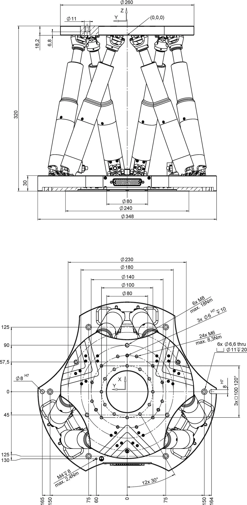

# 实验室卷尺粗测高度记录

日期：2026-11-10。来源：用户实验室卷尺记录、后续更正及所附六轴尺寸图。图纸尺寸与卷尺粗测分别列明，不作为实物标定、控制器行程认证或误差条。粗测未给测量不确定度，保留“约”，转换为 mm 不增加有效精度。

## 当前可用数据

| 对象/参考面 | 用户原始记录 | 模型单位与状态 |
|---|---|---|
| 光斑中心离地 | 138 cm | 约 1380 mm，用户粗测 |
| 大样品台表面转接板顶面离地 | 67 cm | 约 670 mm，用户确认此面接触六轴下转接板下表面 |
| 大样品台可升高量 | 10 cm | 约 0–100 mm 的可升高量；不作为安全运动许可 |
| 六轴本体外表面总高 | 图纸320 mm | 包含本体下盘30 mm和上盘18.2 mm，不能重复相加 |
| 六轴外加转接板厚度 | 用户更正：各15 mm | 位于本体外侧，上下各一块 |
| 六轴含外加转接板总高 | 用户更正：15+320+15 mm | 350 mm，取代此前误读的460 mm |
| 六轴上下盘尺寸 | 图纸上Ø260、厚18.2；下外径Ø348、厚30 mm | 按圆盘包络简化，下盘实际轮廓不是完整圆形 |
| 大样品台水平截面 | 用户指定边长450 mm | 450×450 mm方柱，高度仍约670 mm |
| 黑色升高架高度范围 | 10–20 cm | 约 100–200 mm，作为独立 Z 平台连接六轴上转接板与 XYθ 平台 |
| 现有刚性支撑架上下表面间距 | 44 cm | 约 440 mm，用户确认当前不使用 |

### 2026-11-11 临时对中配置（当前网页默认）

高度复测任务见 [实验几何工作台 #2](https://github.com/David-JA/lab-frame-experimental-geometry/issues/2)，保持 Open。用户要求将基础台面高度提高100 mm：当前网页改为770 mm，保留原670 mm粗测记录，不把770 mm补记为已测尺寸。额外台面升高0–100 mm仍独立，默认取0；方柱外形同步延长并保持柱底在地面。

默认Z平台取200 mm、六轴Y位移取+20.5 mm，保留上方39.5 mm示意安装链：`770+350+20.5+200+39.5=1380 mm`。六轴350 mm是零位含板尺寸，Y位移会抬高上平台，不是新增一块转接板。当前样品中心和固定光束同高；此配置只用于网页对中，待实测的零件尺寸不由高度预算反推成事实。

内部R/H0零位为800 mm，默认H1为1116.4 mm、上转接板顶面1140.5 mm、Z平台上安装面1340.5 mm、样品中心1380 mm。演示pivot在H0取559.5 mm，加当前六轴Y读数20.5 mm后位于LAB1380 mm；它不是实际控制器pivot标定。

本轮从用户当前网页读回：R安装Y=800、P0安装Z=55.5、Z平台200、六轴Y=0时，样品中心1375.5 mm，低于光束4.5 mm。照明模型高3 mm、束高0.2 mm，确实不交叠；棕色外观高35 mm是独立放大示意，不能据此判断照明。预览现显式给出中心相对束心偏差与照明体尺寸。

### 图纸更正后的初始预算（历史默认）

此前高度预算以地面为 y=0、+Y 向上：

- 当前六轴下转接板底面约 y=670 mm；上转接板顶面约 y=670+350=1020 mm。
- 上板顶面距光斑中心约 1380−1020=360 mm；这是上方所有部件到样品目标点的可用高度，不是某一块未测量零件的尺寸。
- 若大样品台额外升高 e，则下板底面为670+e、上板顶面为1020+e，到固定光斑的余量为360−e；0≤e≤100 mm。
- 两外加转接板内表面间距为320 mm，已含本体的上下盘；盘间支杆示意净高320−30−18.2=271.8 mm。
- XYθ 本体、样品/夹具的单项实测高度未提供，不能把剩余高度自动冒充其测量值。

用户确认黑色升高架安装位置，并要求作为新的 Z 平台连接六轴位移台与 XYθ 平台。页面高度使用 cm，范围10–20；内部关节 `z_stage.z` 仍以 mm 保存，原初始值取区间中点150 mm，本轮临时对中改为200 mm。用户要求页面不显示“当前高度未测”，厘米级误差暂不重要；这些是选定配置值，不追记为一次测量。范围是几何配置边界，不是控制器行程认证。

实现复用既有场景/快照：`prismatic`关节的装配链为 H1 → Z0（下安装面，局部+Z朝上）→ Z1（上安装面）→ P0 → θ → XY → S → C。原默认六轴下板底面670、上板顶面1020 mm；Z平台初始上安装面1170 mm。沿用θ/XY/样品示意高度后，原默认样品目标点为1209.5 mm，距光束低170.5 mm；本轮新默认已按上节临时对中。大样品台可通过独立“台面升高0–10 cm”抬高整个装配，光束/探测器固定；柱体外观高度仍是另一个设置。

## 六轴图纸与更正

用户更正此前46 cm为读数错误；本轮以本体320 mm及两外加15 mm板为准。原T9配置与验证结果保留在Git提交 `06a6494`，其460 mm预算不再作为当前尺寸。

图中没有可核验的型号/版本信息，来源仅标为用户提供，不推断厂商或控制器。模型内部H0保留下盘中心、H1保留上盘中心：LAB高度分别700和995.9 mm，H1相对H0为295.9 mm；上转接板中心相对H1为(18.2+15)/2=16.6 mm。厂图(0,0,0)引线指向上盘下表面附近，与H1在位置上相差9.1 mm；厂图Z朝上，本项目LAB Y朝上，本轮不据此建立完整控制坐标映射或修改UVW约定。

上下外加方板边长沿用既有示意比例；支杆连接点、杆径和轮廓为示意，不从图上未标注的长度反推实测值。原合成示例和不带 `upper_disc_size_mm` 的旧快照保持原渲染比例。

## 已澄清但暂不实施

现有 440 mm 刚性支撑架不加入当前装配。未来拟参照它制作较矮支撑件，上下表面间距为 **170 mm**（用户已更正此前的 17 mm 笔误），拟装于大样品台顶面与六轴下转接板底面之间。后续方案再确认承载和安装细节，不在本轮加入模型。

用户希望通过将六轴整体垫高，使其上平台更靠近实验的旋转中心、改善倾转可用范围；这是后续设计意图，本记录不据此声称已验证实际可达行程或机械安全性。

## 非本轮高度实现项

- XYθ 固定孔间距约 9×9 cm，即 90×90 mm；用户记录为 M3 螺丝通孔，未给孔径公差。
- 多用途转接板需求原文：“2.5 方间距转 2 方间距转四个 9×9 间距”。前两项单位/孔阵列定义待后续机械设计确认；不据此推定孔径、板厚或加工图。

当前优先级是厘清参考面、支撑件安装关系与可调高度，保持粗测依据与未测示意尺寸可辨；新高度配置不得被描述为真实装置标定。
