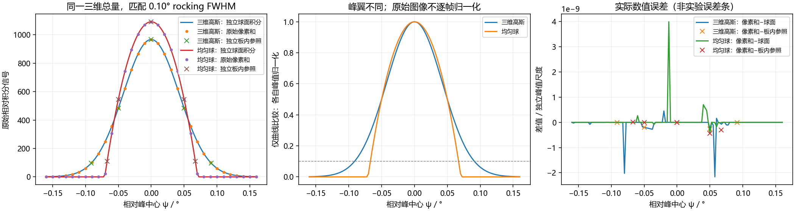
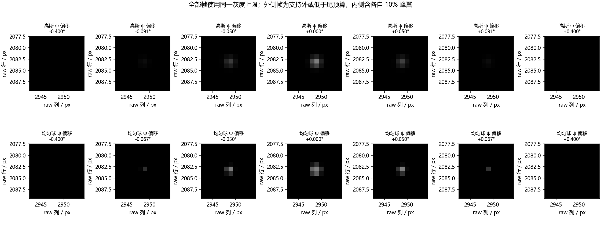
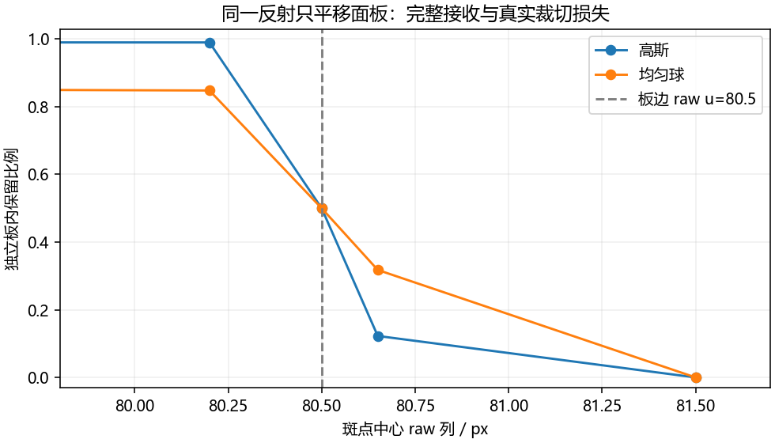
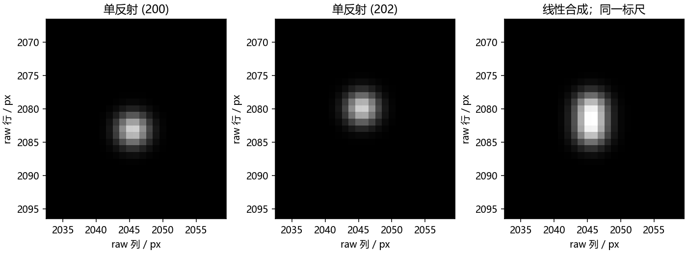

# #3 A：三维反射斑前向模型验证记录

2026-11-13，本地实施基于 `99d0cb1` 的 A 模型通过 synthetic 数值与界面验收，Astra high 第4轮实施复核 PASS。三维倒易密度的 Ewald 球面截取同时决定每帧信号与原始像素分布，保留跨帧相对大小、线性重叠和板边损失。这里验证几何/积分实现，不声称不同 HKL 的真实强弱、绝对计数或实验误差条。B 继续暂缓；[PWA1483 #173](https://github.com/David-JA/single-crystal-stress/issues/173) 持有提峰、质心、dedup 和采集收益验证。

## 结果与边界

| 验收 | 当前结果 | 意义与限制 |
|---|---|---|
| A1 单 HKL rocking | 同一 `(200)`、W=1、四月参照几何；高斯 σ_g=0.000412614890 Å⁻¹，球半径 R_g=0.000687048859 Å⁻¹；独立球面曲线均匹配 0.10° FWHM | 三维总量相同，峰高和峰翼仍不同；不是按单帧峰高归一化 |
| A1 采样/独立板内核对 | .0025°网格129帧/形状，.005°子集，另有半步移相的65个实际像素帧/形状；移相测得0.100173°/0.099938°；14个代表帧独立板面积分 | 宽度均在0.5%门内；代表帧含各自双侧10%及支持外/低于尾预算帧；最大像素和−独立板内参照差/峰值约4.41×10⁻¹⁰ |
| A2 亚像素与板边 | 同一反射仅平移倾斜/非方像素面板，20个案例；150个原始像素有独立参照 | 最大逐像素差/全球面信号约3.91×10⁻⁹；参照误差估计/全球面信号≤7.03×10⁻¹²，细化差≤2.28×10⁻¹⁶，均通过既定门限 |
| A2 中心出板 | raw u=80.5边界保留约0.5；u=80.65时高斯约0.122589、均匀球约0.317676；u=81.5时高斯约4.69×10⁻¹⁵、球为0 | 板外中心仍可能有板内信号，保留比例未归一化回1；高斯“失收”是低于声明预算 |
| A3 重叠 | 同一显式 synthetic 的1000 Å立方晶胞、共同旋转、整数 `(200)`/`(202)`；494个raw像素有双贡献 | 两个单独入口求和与共同输入的最大raw残差3.55×10⁻¹⁵，位置(2045,2080)，通过逐像素线性门；该大晶胞仅用于隔离重叠算子，不代表真实材料 |

生产实现以 Ewald 球面圆环与实际像素方向锥的交集积分；独立参照在物理探测器平面做 Cartesian 求积，并独立求解锥面/像素边界交点。参照不会从生产图反算，也不调用生产像素积分函数。参照高斯支持使用10σ，样例的被忽略球面尾量远低于参照误差门；球斑使用完整支持。记录同时保留参考求积误差与再细化差，不把二者当作实验置信区间。









全部科学图使用 Microsoft YaHei，已检查中文字形、负号及数学符号，无缺字警告。帧图与重叠图在各自对比组内使用同一灰度上限，raw数组不随映射改变。曲线中的峰值归一化只用于比较峰翼，原始信号另存。

## 原始证据与复算

[validation.json](./validation.json) 保存求积控制量和误差门、A1 的完整 snapshot/模型参数、实际姿态矩阵、标量扫描、移相序列及代表帧 Float64 数值；A2 的同一反射/移动板面/各像素 raw tile；A3 的单独与共同输入、全局 raw 联合 ROI 数组及残差位置。tile 的 `u0/v0` 是 raw 原点，`data` 按行优先，未存的像素为零；重叠 tile 按全局 raw 坐标相加。[independent-reference.json](./independent-reference.json) 保存独立参照的板内信号、实际损失、像素值、误差估计和细化差。

这两份轻量数值与四张关键图保留为人工核查及 #173 对接的实际证据。大型/重复运行中间物及浏览器截图留在 ignored `artifacts/issue3-forward/`。重建使用本仓实现，不依赖私有 PWA 数据；Node 24+ 和项目依赖由原有 package-lock 持有，独立审计另需 Python 的 numpy/scipy/matplotlib（本次使用现有环境，没有新增安装）。

在仓库根目录的 PowerShell 中执行：

```powershell
$env:FORWARD_AUDIT_OUTPUT='artifacts/issue3-forward/validation.json'
npm test -- --run tests/forward-acceptance.test.ts
python examples/reciprocal-spot-validation.py artifacts/issue3-forward/validation.json
Remove-Item Env:FORWARD_AUDIT_OUTPUT
```

纯数值入口是 `src/diffraction/frames.ts` 的 `computeForwardFrames(snapshot, poses, options)`；`poses` 为固定姿态 ID 与关节值列表，返回实际 snapshot、晶体矩阵、g/Q口径、固定球面测度及各反射原始tile/误差状态。它与 UI 共用 `DiffractionModel`/`integrateReflection`，不建立第二套前向算法。审计参照默认不在实时路径执行，相关reference字段为null；`received_fraction_estimate` 是原始像素和/全球面积分的数值估计，J=0 时为null。

当前执行 `npm test -- --run` 为132项单测通过；`npm run build`包含typecheck并通过；25条真实Edge浏览器流程通过。浏览器运行仅为该进程补 loopback `NO_PROXY`，在正常Windows用户边界使用独立4173测试服务；未停止用户的5173服务。代码保留原有约1秒运动采样与关窗停算，新增预算失败/未解析状态不宣称空帧合法。包体积提示仍存在，本轮没有扩展为拆包任务。

实现的[数学与兼容合同、完整评审处置](../../../discuss/20261113_issue3_reciprocal_spot_forward_spec.md)由 Spec 持有；本批实现提交至 [PR #4](https://github.com/David-JA/lab-frame-experimental-geometry/pull/4) 审查，尚未合并或发布，不代表在线版本已更新。
